  

---

### Socials:

    

---

### Achievements:

   
   
   
   
   

---

### Tech Stack:

#### Languages

     

#### Frontend

    

#### Backend

       

#### Web3

   

---

### Contribution:

<picture>
  <source media="(prefers-color-scheme: dark)" srcset="https://raw.githubusercontent.com/wngstnr-code/wngstnr-code/output/pacman-contribution-graph-dark.svg">
  <source media="(prefers-color-scheme: light)" srcset="https://raw.githubusercontent.com/wngstnr-code/wngstnr-code/output/pacman-contribution-graph.svg">
  
</picture>

<!-- Proudly created with GPRM ( https://gprm.itsvg.in ) -->
